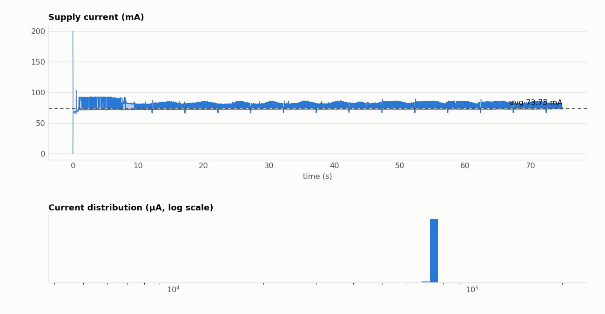
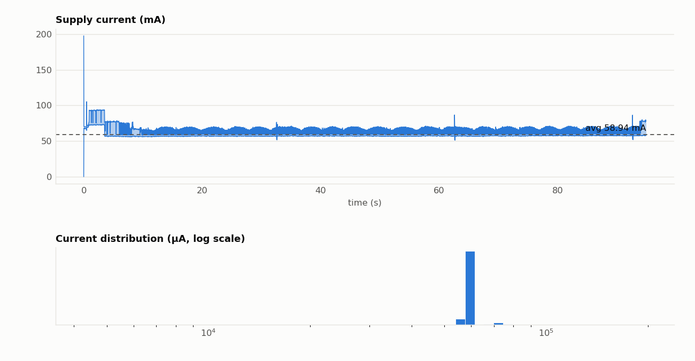
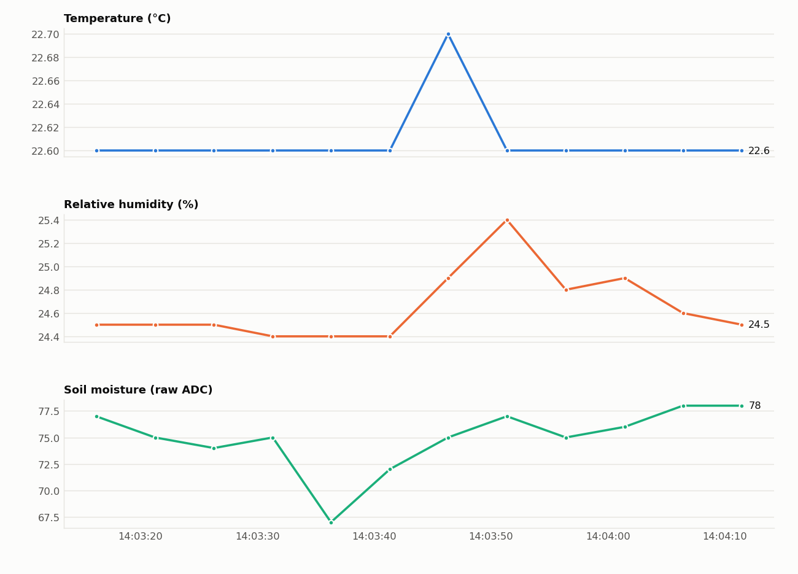

# Ambient IoT sensor node

This is a low-power sensor node that measures temperature, humidity and soil moisture and sends the readings over Bluetooth Low Energy (BLE). It is based on the *IoT Project Oulu* guide ([docs/project_manual.pdf](docs/project_manual.pdf)). The manual uses an STM32 Nucleo L412KB as the main board. This build uses an **Arduino Nano R4** (Renesas RA4M1) instead, with a **Seeed XIAO nRF52840 Sense** handling the BLE side.

```
SHT3x  ──I2C (A4/A5)──┐
Soil   ──A0 / D12 ────┤  Nano R4  ──UART (D0/D1)──►  XIAO nRF52840  ──BLE──►  phone / PC
                      └─ framed packets: 0x02 "temp,hum,soil" 0x03
```

## Layout
| Path | Contents |
|---|---|
| [nano_r4_sensor_node/](nano_r4_sensor_node/) | Nano R4 firmware. Reads the sensors, frames the data and sends it to the XIAO. Sleeps in RA4M1 Software Standby between readings, woken by the RTC every 30 s. |
| [xiao_ble_bridge/](xiao_ble_bridge/) | XIAO firmware. Bridges UART to BLE using the Nordic UART service, advertising as `IoT_Node`. Prints a status line over USB every 2 s. |
| [tools/](tools/) | `iot_monitor.py`: logs readings (BLE, beacon, or serial), drives a PPK2 power profiler directly, and builds self-contained HTML reports. See [tools/README.md](tools/README.md). |
| [data/](data/) | Measurement runs, reports and compressed PPK2 captures (`*.csv.gz`). |
| [docs/](docs/) | Project manual and the hand-drawn wiring sketch. |
| [reference/](reference/) | The original course sources: the STM32 CubeIDE projects (unoptimized and STOP2-optimized) and both XIAO sketches (full connection and burst beacon). |

## Wiring (Nano R4)
| Signal | Nano pin |
|---|---|
| Soil sensor VCC (switched on only while reading) | D12 |
| Soil sensor signal | A0 |
| SHT SDA / SCL | A4 / A5 |
| SHT VIN | 3V3 |
| XIAO TX → Nano RX | D0 |
| Nano TX → XIAO RX, **through a 1 kΩ / 2 kΩ divider** (the Nano uses 5 V logic, the XIAO is 3.3 V only) | D1 |
| XIAO 3V3 | Nano 3V3 |
| Shared ground | GND |

## Building and flashing
```
arduino-cli core install arduino:renesas_uno
arduino-cli compile -b arduino:renesas_uno:nanor4 nano_r4_sensor_node
arduino-cli upload  -b arduino:renesas_uno:nanor4 -p COMx nano_r4_sensor_node
```
- **Low-power firmware:** USB stops working while the Nano sleeps. To re-flash, double-press reset first, or set `LOW_POWER 0` for USB debugging.
- **XIAO:** install the board package `Seeeduino:nrf52` and use the board `Seeeduino:nrf52:xiaonRF52840Sense`. The Seeed toolchain fails if the project path contains a space, so build from a path without one.

## Results so far
Measured with a PPK2 supplying the whole system with 5 V on the Nano's +5V pin (about 4.5 V measured).

| Configuration | Average current | Peak | Average power | Full report |
|---|---|---|---|---|
| Baseline: 5 s interval, BLE connected, MCU always on | **73.8 mA** | 200 mA (power-up) | ~330 mW | [baseline_report.html](data/baseline_report.html) |
| Step 1: Nano in Software Standby, 30 s interval | **58.9 mA** | 197 mA (power-up) | ~265 mW | [lowpower_report.html](data/lowpower_report.html) |

To view a full report, download the HTML file and open it in a browser; GitHub doesn't render HTML files. The raw PPK2 captures are in `data/*.csv.gz` (10 kHz, `Timestamp(ms),Current(uA)`).

### Baseline power profile


- **0–8 s:** the XIAO advertises, with spikes up to about 93 mA, until a central connects.
- **After 8 s:** a steady base of about 73 mA plus roughly 10 mA of ripple from the BLE connection's regular check-ins.
- **Small dips every 5 s:** the Nano's measure-and-send cycles.

### Step 1: MCU Software Standby


About 3.5 s after power-up the RA4M1 first enters Software Standby, and the current drops by about 17 mA (75 → 58 mA). That is the MCU's whole share. Pulling the XIAO's and the SHT's power wires changed the current by less than about 1 mA, so the remaining ~58 mA comes from the Nano board itself. That is the next thing to find.

### Sensor readings (baseline run, received over BLE)


The soil probe was in air during these runs, so its raw values are close to zero and don't mean much yet.

Planned next: find the source of the Nano board's ~58 mA standby current, switch the XIAO to burst-beacon mode (`BURST_BEACON_MODE 1`), remove the LEDs, then move to energy harvesting (supercapacitor, BQ25570 PMU, solar).
